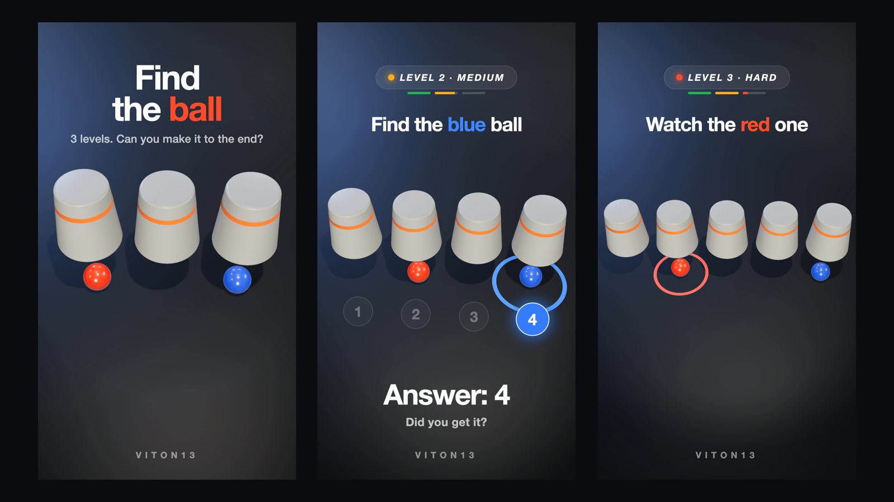
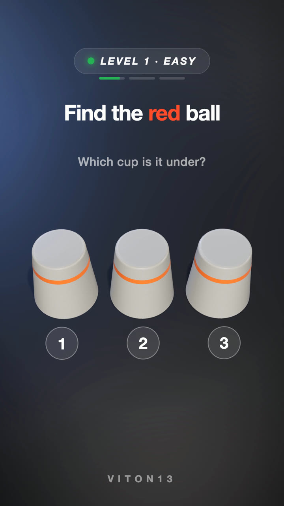
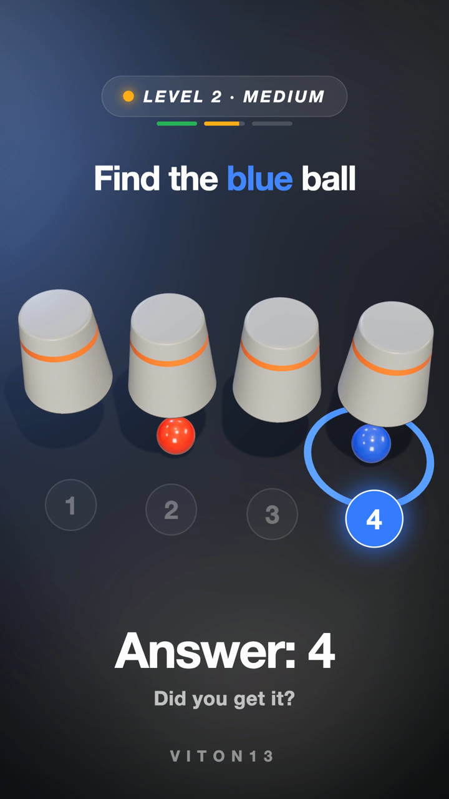

# Find the Ball

A three-level cup-shuffle puzzle, rendered live in 3D.

[Live demo](https://viton13com.github.io/find-the-ball-3d/)  ·  [viton13.com](https://viton13.com)

<br>

Watch the red ball, then the blue one, as the cups shuffle faster with every level — three cups, then four, then five. Made as a vertical 9:16 short for social feeds, it runs as a WebGL page in any browser and renders to video frame by frame.

Every shuffle comes from a seeded timeline shared by the picture and the sound, so the puzzle is identical on every play and the audio hits each swap exactly. English or Russian with `?lang=en` / `?lang=ru`.

<br>

<table><tr><td></td><td></td></tr></table>

### Inside
- Three levels: 5, 9 and 15 swaps
- Deterministic seeded shuffles, pure `seek(t)` timeline
- Countdown, numbered cups and answer reveal
- Synthesized music and foley in sync with every swap
- English and Russian captions

### Run
```bash
npx serve .            # open the printed URL; ?play=0 holds the first frame
npm install            # only for offline rendering (Chrome + ffmpeg)
npm run sound && npm run render
```

### Stack
three.js · WebGL · vanilla JS · Puppeteer · ffmpeg

<br>

---

<sub>Source-available, not open source. © 2025–2026 VITON13. Free for personal, study and non-profit use under <a href="LICENSE.md">PolyForm Noncommercial 1.0.0</a>. Commercial use needs a license — <a href="mailto:info@viton13.com">info@viton13.com</a> · <a href="COMMERCIAL.md">details</a>.</sub>

<sub>По-русски: «Найди шарик» — 3D-головоломка со стаканчиками на three.js в трёх уровнях; коммерческое использование — только по договорённости.</sub>

<sub>Credits: three.js r186 (MIT, <a href="vendor/three/LICENSE">vendor/three</a>).</sub>
